# Red hybrid alt kit: cyber frames + chrome

The cyber frame elements and the chrome-looking pieces of the Winter Edition's **blue HUD build**, kept as an opt-in alternate look. Nothing in the live site imports this folder.

- **Source:** branch `winter-redesign` @ **`c9688b5`**. That is the last state before commit `e88ce36` ("Red hybrid H0") flattened the buttons, dropped the grain, the scanlines and the HUD nav, and neutralised the chrome. Its preview is https://winter-redesign.agapefestival.pages.dev/.
- **Palette:** the CSS keeps the build's accent names (`ice`, `volt`, `steel-blue`).
  - By default they resolve to red, the way `e88ce36` re-pointed them for red hybrid.
  - `<RedHybridKit palette="blue">` brings back the original blues.
- **Showcase:** `/kit/red-hybrid/`. It renders on Cloudflare branch previews and in `next dev` only (see [Showcase](#showcase)).
- **Look:** preserved as it was, maximal: chrome gradients with the hard 48/52% break, bevels, chamfers, notches, sheen, glows, scanlines, boot and lock-on animations.

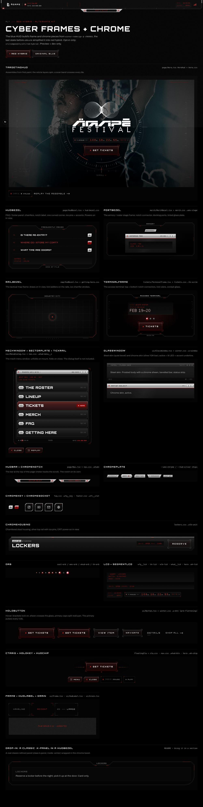

---

## Use it

```tsx
import { RedHybridKit, HudBezel, HoloButton } from "@/components/alt/red-hybrid";
import { winterFontVariables } from "@/components/winter/fonts";

<RedHybridKit className={winterFontVariables}>
  <HudBezel label="Tickets">
    …
    <HoloButton href="https://dice.fm/…" external>Get tickets</HoloButton>
  </HudBezel>
</RedHybridKit>
```

- **`RedHybridKit` is required.** It loads `red-hybrid.css`, and every rule and token in it is scoped under its `.rhk` class.
  - Classes are `rhk-*`, keyframes `rhk-*`, tokens `--rhk-*`.
  - Nothing can leak into the classic-refined site, and the site's `--w-*` / `--c-*` tokens are never redefined.
- **Fonts come from the page.** The kit reads `--font-hud` (Orbitron), `--font-pixel` (Chonky Pixels) and `--font-body` (falling back to `--font-ui`, Archivo here).
  - In this app, put `winterFontVariables` on the wrapper or an ancestor.
- **No new assets.** The film grain is an inline SVG. The showcase borrows the existing hero still, logo and mark.
- **Server / client:** the bezels, `HudBar`, `MechWindow`, `TargetingHud`, `CtaRig`, `ChromeHousing` and `ChromeNotch` are client components (they measure, observe or animate). Everything else is plain markup.

### Drop one into a classic section

Wrap a classic panel in a bezel. Pass `fill={false}` so the panel keeps its own glass, and pad the host so the panel clears the notch:

```tsx
<RedHybridKit className={winterFontVariables}>
  <HudBezel label="Lockers" fill={false} style={{ "--bz-pad": "40px 24px 28px" } as React.CSSProperties}>
    <div className="k-panel">…classic content…</div>
  </HudBezel>
</RedHybridKit>
```

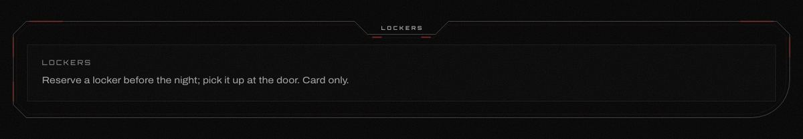

Other one-liners:
- **Chrome kicker over a classic heading:** `<ChromePlate shape="slant">Apparel</ChromePlate>`.
- **Hologram ticket button instead of the flat one:** `<HoloButton href={TICKETS.url} external>Get tickets</HoloButton>`.
- **A `.k-panel` as a skinned window:** `<GlassWindow title="Lockers" skin="chrome" active>…</GlassWindow>`.
- **Scope only the bit you restyle.** `.rhk` sets `color` and font smoothing on its subtree, nothing else.

---

## Components

Each screenshot shows **the c9688b5 original** (left or top), then **the port in `palette="blue"`**, then **the port in the default red palette**.

### Frames and bezels

#### `HudBezel`
The FAQ terminal's and the footer's frame.
- Chamfered corners, and a centre notch on the top edge housing the label (it is sized to the label).
- A second ice hairline 6px inside, and **one curved corner** (bottom-right).
- Connector pins, ice accent segments, and an optional bottom notch.
- It powers on with a stepped flicker when it scrolls into view.
- It is drawn as SVG at the measured pixel size, so the chamfers never stretch.
- Source: `page/HudBezel.tsx`, `sections/hud-bezel.css`.

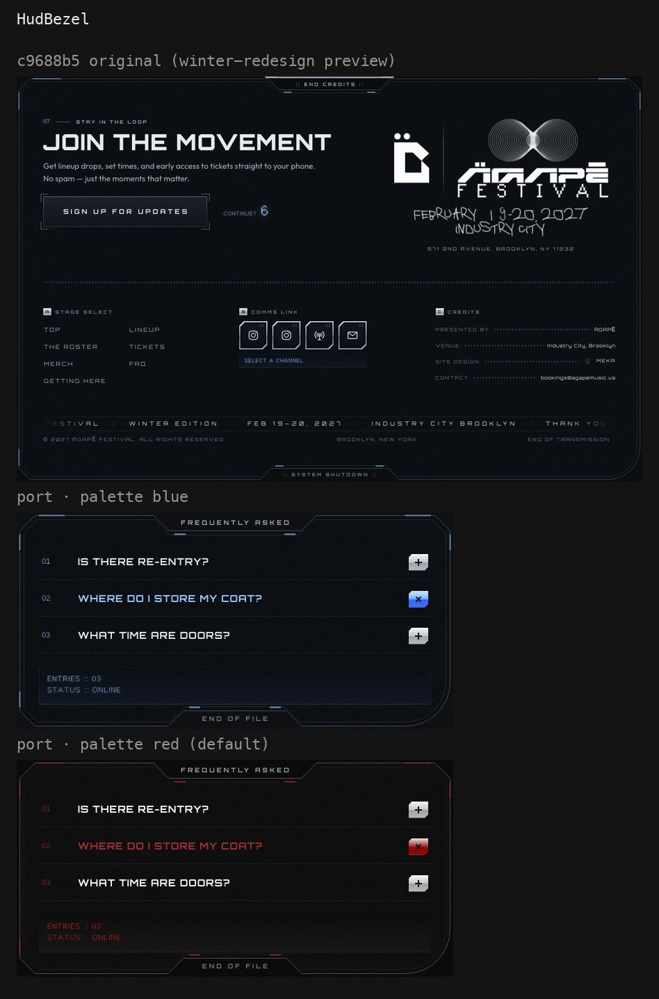

| Prop | Type | Default | |
|---|---|---|---|
| `label` | `string` | required | top notch caps |
| `bottomLabel` | `string` | | adds the bottom notch |
| `fill` | `boolean` | `true` | panel glass in the bezel's shape (`--bz-fill` overrides the colour) |
| `power` | `boolean` | `true` | power-on flicker in view |
| `as`, `className`, `style` | | `div` | padding via `--bz-pad` (default `44px 28px 32px`) |
| `children` | | | the panel content |

#### `PortBezel`
The merch armory's frame. It is the roster's StageFrame with docking ports added.
- Chamfers and a notch connector housing the label.
- Pins in the notch, and three-tick ports on both side edges.
- A tinted glass plate (scanlines + a steel core) clipped to the same shape.
- Source: `merch/MerchBezel.tsx`, `merch.css .wmx-stage / .wmx-frame*`.

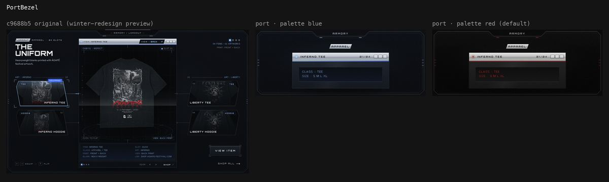

| Prop | Type | Default | |
|---|---|---|---|
| `label` | `string` | required | |
| `ports` | `boolean` | `true` | `false` = the roster's StageFrame |
| `glass` | `boolean` | `true` | the clipped glass plate |
| `as`, `className`, `style` | | `div` | padding via `--pb-pad` (default `30px 12px 14px`) |

#### `RailBezel`
The tactical map's frame.
- Chamfers and a notch label.
- An outer line that draws itself on, plus an ice hairline inside.
- Chrome pins, tick ladders outside both side rails and under the bottom edge, and ice strokes along every chamfer.
- It boots in view: the line draws, the chrome flickers, the label decodes.
- Source: `map/HudBezel.tsx`, `getting-here.css .wgh-bezel*`.

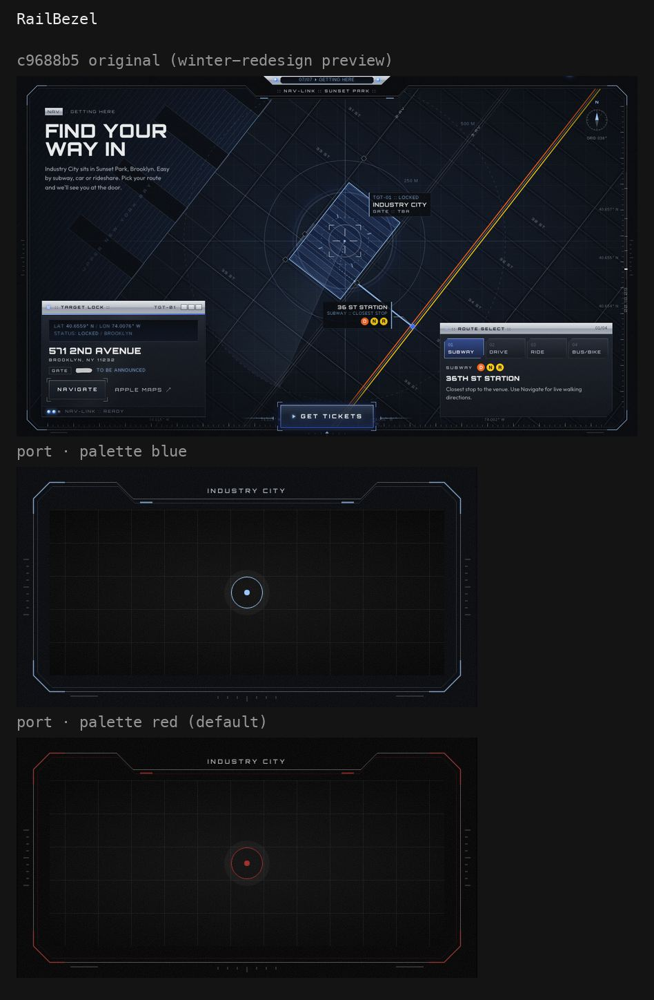

| Prop | Type | Default | |
|---|---|---|---|
| `label` | `string` | required | |
| `boot` | `boolean` | `true` | draw-on + flicker + decode in view |
| `as`, `className`, `style` | | `div` | padding via `--rb-pad`; the rails sit 6–14px **outside** the box, so leave room |

#### `TerminalFrame`
The ticket access terminal's cockpit bezel.
- A top notch connector holds the label (frost); a shallower bottom one holds the foot (fog).
- An ice hairline, pin pairs, and tick rulers down both sides (a long tick every 5th).
- Optional cockpit glass behind it: scanlines, a cold core, and a hairline grid fading out radially.
- Source: `tickets/TerminalFrame.tsx`, `tickets.css .tk-term / .tk-scrim / .tk-frame*`.

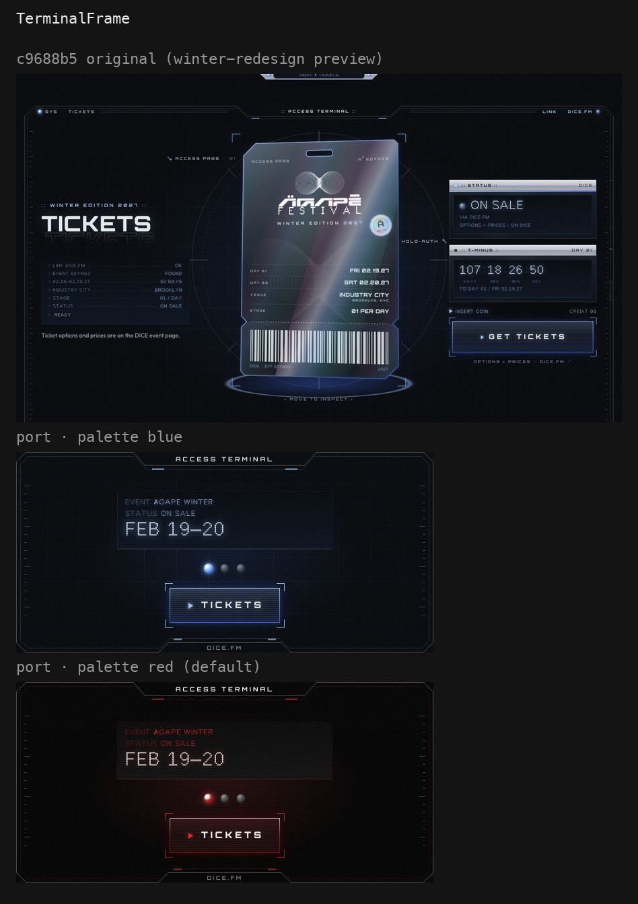

| Prop | Type | Default | |
|---|---|---|---|
| `label` | `string` | required | |
| `foot` | `string` | | bottom notch caps |
| `glass` | `boolean` | `true` | cockpit glass |
| `power` | `boolean` | `true` | flicker on in view |
| `as`, `className`, `style` | | `div` | padding via `--tf-pad`; inset the frame with `--tf-ft/fx/fb` |

#### `TargetingHud`
The hero's targeting HUD, around any centred content.
- **Frame:** viewfinder corners with ice knee ticks, and registration crosses.
- **Reticle:** two slow counter-rotating layers (120 + 24 radial ticks; four arcs + two hot ice arcs), with axis lines running out to it.
- **Instruments:** pitch rulers, a heading tape with the scroll cue, and a vertical caps strip.
- **Readouts:** LCD rows that type in.
- **Motion:** a scan band every 8s, and intro glitch slices.
- It assembles from first paint (CSS only) and parks its loops off screen.
- The viewport units became container units, so it fits any box. The tape hides when the box is under 700px tall, as the hero's did.
- Source: `page/Hero.tsx HeroHud`, `hero.css`.

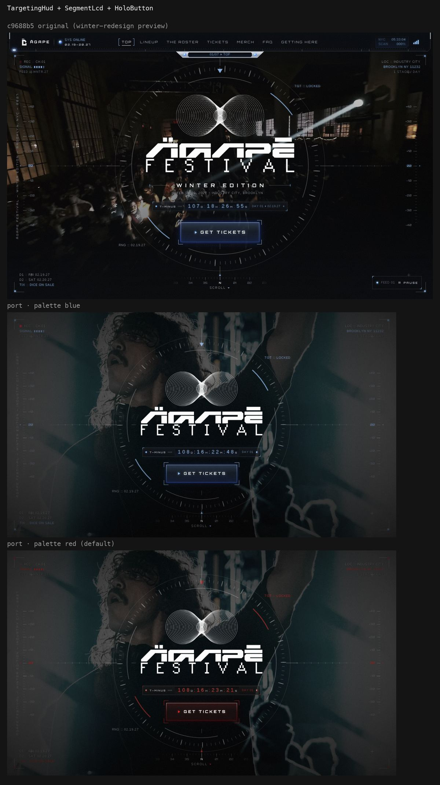

| Prop | Type | Default | |
|---|---|---|---|
| `children` | | | the centred lockup |
| `data` | `{ tl?, tr?, bl?: HudRow[] }` | | `HudRow` = node, or `{ content, tone: "ice" \| "fog" }`; `<i>` = dim separator; `<HudRec />` = the blinking REC dot |
| `tags` | `{ ne?, sw?: HudRow }` | | readouts riding the reticle |
| `ruler` | `string[]` | `+40 … -40` | 9 labels, the middle one lit |
| `tape`, `north` | `string[]`, `string` | `33 … 03`, `"N"` | |
| `cue` | `string` | `"Scroll"` | `""` hides it |
| `vtext` | `string` | | left-edge vertical caps |
| `as`, `className`, `style` | | `div` | height via `--th-h` (min-height, default 640px) |

#### `HudBar` (+ `HudBarBrand`, `HudBarStatus`, `SignalBars`)
The HUD top bar. It is the bar at the top of the showcase.
- **Frame:** a chrome frame hung from the top edge (caps with silver clamps, scanlined runs), with the `ChromeNotch` under its centre.
- **Meter:** a scroll meter with a tick per section, a fill, an instrument ruler and a glint.
- **Links:** with the **lock-on bracket** that slides to the current one.
- **Readouts:** status and end slots.
- It boots on mount: the shell flickers, modules slide in, the notch unfolds.
- Breakpoints follow the bar's own width (container queries), not the viewport.
- Source: `page/Nav.tsx`, `nav.css .whud*`.

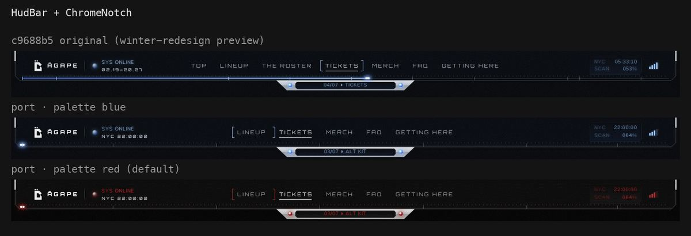

| Prop | Type | Default | |
|---|---|---|---|
| `brand`, `status`, `end` | node | | slots. `status` gets the separator + a breathing orb |
| `endWide` / `endNarrow` | node | | shown only ≥1220px / <1100px bar width |
| `links` | `{ label, href, current? }[]` | | centre links (≥1100px) |
| `notch` | `string` | | notch LCD text; decodes on change; omit = no notch |
| `progress` | `number` 0–1 | page scroll | meter fill |
| `ticks` | `number[]` | `[]` | tick positions (they light as the fill passes) |
| `solid`, `compact`, `fixed` | `boolean` | `true`, –, – | scrolled shell / slim strip with folded notch / `position: fixed` |

#### `MechWindow` + `SectorPlate` + `TickRail`
The mobile menu's window.
- **Shell:** a chamfered steel bezel with a gradient ring, four snapping corner brackets, a silver title bar (LED, title, meta, controls) with an accent underline, and a boot LCD.
- **Plates:** sector plates, each with a silver hex index chip, a display label, and a state tag (lit volt on the current plate).
- **Status strip:** chamfered, with orbs. Tick rails run outside both sides.
- **Unfold:** on mount. The bezel grows, brackets snap, plates flip down on hinges, labels decode, a scan band sweeps.
- **Fold:** when `open` turns false. The dialog, focus trap and scroll lock of the original menu are left out; this is the window.
- Source: `nav/MenuDialog.tsx`, `nav.css .whud-menu__*`.

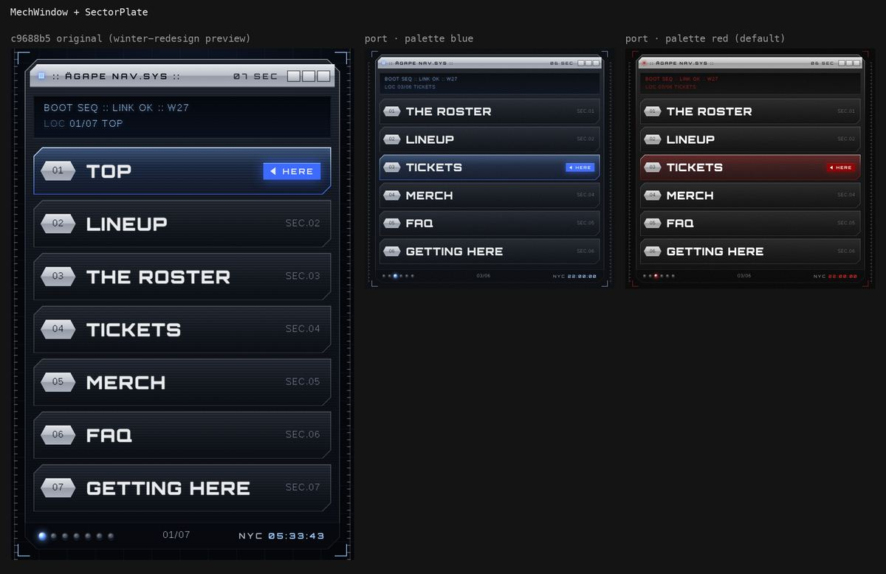

| `MechWindow` prop | Type | Default | |
|---|---|---|---|
| `title`, `meta` | node | required, – | silver bar |
| `lcd` | node[] | | boot rows (strings decode) |
| `plates` | `SectorPlateProps[]` | | the list |
| `children` | | | more body content |
| `status`, `statusOrbs` | node, `{ count, lit? }` | | status strip |
| `rails`, `controls` | `boolean` | `true` | |
| `open` | `boolean` | `true` | false folds; true again replays the unfold |

| `SectorPlate` prop | Type | |
|---|---|---|
| `index`, `label` | `string` | hex chip, display label |
| `state` | node | right readout (`SEC.03`, `◀ HERE`) |
| `current` | `boolean` | ice ring, lit glass, volt tag |
| `href` / `onClick` | | `<a>` or `<button>` |

`TickRail`: `side: "l" | "r"`, absolutely positioned.

### Chrome and glass

#### `GlassWindow`
The skinned "app window".
- A frosted steel body with a chrome sheen.
- A bevelled title bar (LED, title, meta, window controls) and an optional status strip.
- `skin="chrome"` is the silver Y2K bar. `active` lights the LED and draws the accent underline.
- Source: `ui/GlassWindow.tsx` + `winter.css .w-window`, as in the blue build (the `e88ce36` version is neutralised).

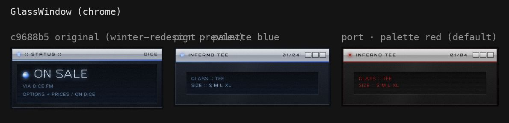
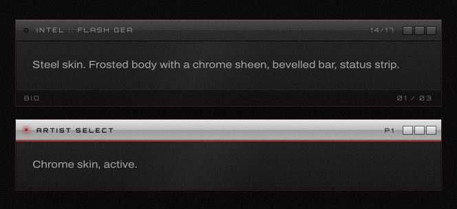

Props: `title`, `meta?`, `status?`, `skin: "steel" | "chrome"`, `active?`, `flush?`, `controls?` (true), `as`, `className`, `aria-label`.

#### `ChromePlate`
The silver bevel chip: four stops with a hard break at 48/52%, a white top bevel, and ink caps. Inside it, `<b>` is the deep accent and `<i>` is dimmed.
- Shapes: `slant` (merch kicker), `chevron` (lineup spine node / menu index), `tab` (title-bar corner), `trap` (roster RANDOM key), `rect` (lockers / map tag).
- Source: `--wmx-chrome` / `--hud-silver`.

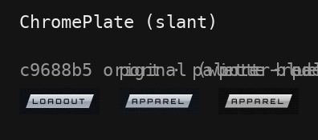
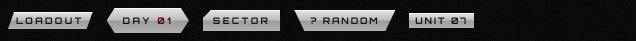

Props: `children`, `shape` (`slant`), `as` (`span`), `className`.

#### `ChromeKey`
The FAQ's chrome keycap.
- A chamfered silver key with a + that rotates to ×, while an ice glass state crossfades in.
- `on`, `aria-pressed="true"` or `aria-expanded="true"` switch it.
- Source: `faq.css .wfq__key`.

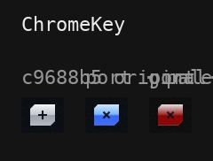

Props: `on?`, `aria-label` (required) + any button attribute.

#### `ChromeSocket`
The footer's comms slot.
- A chamfered silver ring around a recessed dark well with scanlines, and a pixel index.
- The icon lifts and turns ice on hover.
- Source: `footer.css .wft__slot`.

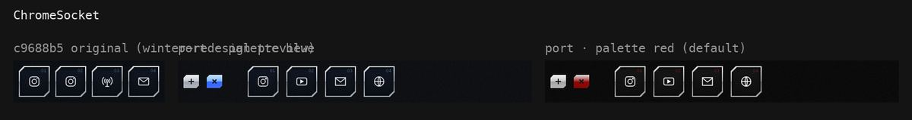

Props: `icon`, `label` (accessible name), `index?`, `href?` + `external?` (else a button with `onClick`), `className`.

#### `ChromeHousing`
The lockers band's unit.
- A chamfered steel housing with scanlines and an ice hairline.
- A silver top rail with two ice pins.
- A CRT power-on in view.
- Source: `lockers.css .wlk-unit`.

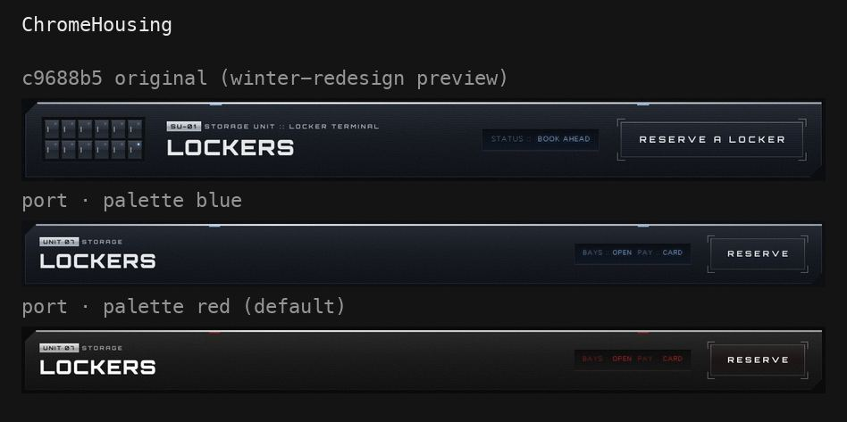

Props: `children`, `rail` (true), `power` (true), `as`, `className`, `style` (padding via `--housing-pad`).

#### `ChromeNotch`
The silver trapezoid hung under the HUD bar.
- A dark edge and two lit glass orbs.
- A recessed chamfered LCD whose text decodes in, with a sweep on every change.
- Source: `nav.css .whud-notch*`.

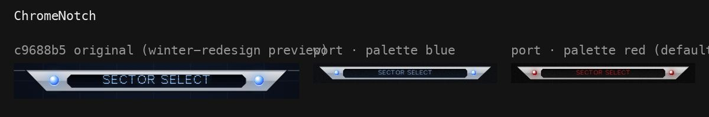

Props: `text`, `orbs` (true), `size: "md" | "lg"` (228×18 / 300×22), `className`.

#### `Orb`
The roster's glass orb indicator (also used by the merch, FAQ, nav and tickets).
- Dark glass at rest. `lit` crossfades in the ice core and its glow.
- `beat` breathes and `blink` blinks; both are folded long loops.
- Source: `asel-orb`, `wmx-orb`, `wfq__orb`, `whud-orb`, `tk-orb`.

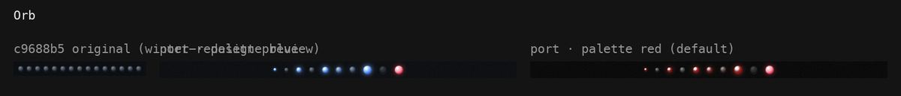

Props: `lit?`, `size: "xs" | "sm" | "md" | "lg"` (5 / 8 / 11 / 14px; default 10), `beat?`, `blink?`, `locked?`, `tone: "ice" | "p2"` (the roster's Day 2 crimson), `className`.

#### `Lcd`
The recessed pixel LCD.
- A navy well with an inset shadow and an ice hairline.
- Glowing Chonky Pixels rows, with scanlines.
- In a row, `<i>` is a dim label and `<b>` is a lit value.
- Source: `wfq__lcd`, `wmx-lcd`, `tk-lcd`, `wlk-lcd`, `whud__lcd`.

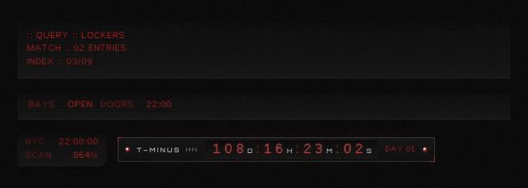

Props: `rows?: node[]`, `pairs?: { k, v }[]` (key :: value on one line), `big?` (the terminal's big line), `shape: "plain" | "chamfer"` (the bar readout), `decorative` (true = `aria-hidden`), `className`, `style`.

#### `SegmentLcd`
The hero countdown strip.
- Left to right: an orb, lead caps and a ruler; a recessed digit window; pixel meta and a blinking orb.
- The digit window has an **unlit 8 behind every digit** and unit letters.
- It sits inside a dim hairline with two ice corner ticks, powers on like a CRT, and blinks its colons.
- Feed it values; it does not tick by itself.
- Source: `HeroBits Countdown`, `hero.css .wh-lcd`.

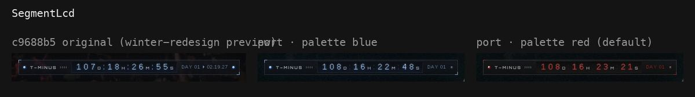

Props: `groups: { value, unit? }[]`, `label` (accessible reading, required), `lead?`, `meta?`, `orbs` (true), `power` (true), `live` (true), `fontSize?`, `className`.

### Hologram controls and HUD bits

#### `HoloButton`
The hologram buttons before `e88ce36` flattened them.
- A pane of ice glass with scanlines, inside a 1px luminous ice→volt edge.
- **Lock-on brackets** on all four corners. On hover, focus or press they snap in with an overshoot and a flicker.
- A holographic **sheen** sweeps across on hover.
- The primary also has:
  - the ▶ transport glyph;
  - **red/cyan split caps** on hover;
  - a halo that flares, and a ring that **pings** outward, every 4.8s.
- Source: `ui/Button.tsx` + `winter.css .w-btn` at c9688b5.

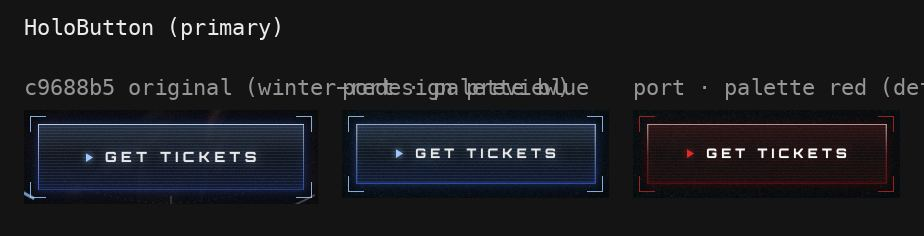
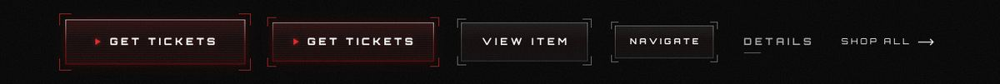
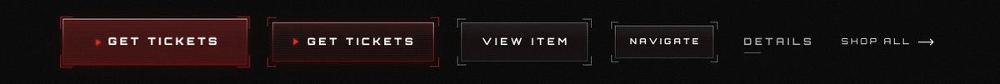

Props: `variant: "primary" | "secondary" | "ghost" | "link"`, `size: "sm" | "md" | "lg"` (primary defaults to `lg`), `href?` + `external?` (else a button), + native attributes.

#### `HoloKey`
The HUD bar's MENU / CLOSE key: chamfered ice glass with scanlines inside a 1px luminous chamfered ring.
- Source: `nav.css .whud-btn`.

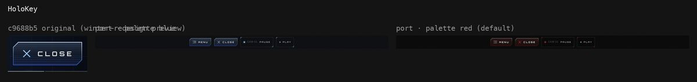

Props: `children` (caps), `icon: "burger" | "close" | node`, + button attributes.

#### `HudChip`
The hero's video chip: a dark pane with a dim hairline, two ice corner ticks, an LED, tracked caps, and an optional pixel feed.
- Source: `hero.css .wh-chip`.

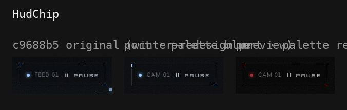

Props: `children`, `on?`, `feed?`, `icon?`, + button attributes.

#### `CtaRig`
The floating Get tickets' HUD chrome, around any button.
- A legibility pool with an ice bloom on the 4.8s beat.
- Hairline rails with tick rulers, which extend in.
- Readouts on the rails that type in.
- A pip under the button. The brackets of a `HoloButton` inside re-acquire when it shows.
- The dock / hide logic is left out: drive `shown` yourself.
- Source: `page/FloatingCta.tsx`, `cta.css`.

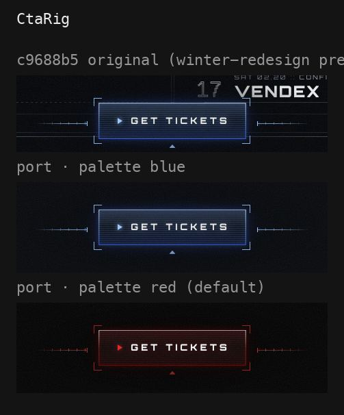

Props: `children`, `left?`, `right?`, `shown` (true), `className`.

#### `Frame`, `HudLabel`, `Grain`
- **`Frame`:** the corner-bracket frame on one `::after`. Props: `accent`, `hairline`, `size`, `interactive`, `as`.
- **`HudLabel`:** the Orbitron / pixel micro-label. Props: `tone`, `font`, `size`, `index`, `rule`.
- **`Grain`:** the blue build's **film grain**, which red hybrid replaced with plain scanlines.
  - `opacity` (default 0.075).
  - `animated`: a stepped tile jitter, fine pointers only.
  - `local`: cover the positioned parent instead of the viewport.
- `.rhk-selected` is the blue build's selection ring.

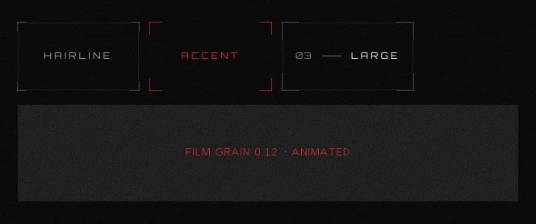

### Helpers

- **`decode(el, text, { ms, delay, pre })`:** the HUD text decode. One shared rAF loop, direct `textContent` writes; reduced motion just sets the text.
- **`armEntrance(el)`:** `data-armed` → `data-in` when the element scrolls into view.
- **`parkOffscreen(el)`:** toggles `data-off` while the element is off screen.
- **`useMeasure()`:** the bezels' resize-only measuring hook.
- **`cx`:** class join.

---

## Tokens and the two palettes

Defined on `.rhk` (red) and on `.rhk[data-palette="blue"]`.

| Token | Red (default) | Blue (c9688b5) |
|---|---|---|
| `--rhk-ice` (lines, marks) | `#a42b2b` | `#9cc8ff` |
| `--rhk-ice-text` (ice used as text) | `#e52424` | `#9cc8ff` |
| `--rhk-volt` (fills, glows) | `#8b0000` | `#3d6bff` |
| `--rhk-volt-glass` (translucent volt) | `rgba(200,0,0,.6)` | `#3d6bff` |
| `--rhk-volt-deep` | `#5a0000` | `#1e3bb8` |
| `--rhk-steel-blue` | `#5c5c5c` | `#5a6f89` |
| `--rhk-ink` / `-deep` / `-steel` | `#000` / `#0b0b0b` / `#1f1f1f` | `#04060a` / `#1b212c` / `#313743` |
| `--rhk-frost` / `-mist` / `-fog` | `#fff` / `#a6a6a6` / `#777` | `#e9ebec` / `#a7afba` / `#737c8b` |
| `--rhk-bracket` / `-bracket-accent` | `#ffffff35` / `#ff2a2a99` | `rgba(233,235,236,.34)` / `rgba(156,200,255,.85)` |
| `--rhk-accent-line` | `#a42b2b` | `linear-gradient(90deg, #9cc8ff, #3d6bff)` |
| `--rhk-pale`, `--rhk-sky`, `--rhk-cyan`, `--rhk-orb-*` | greys / reds | `#d6e8ff`, `#6eaaff`, `#78c8ff`, the orb's `#cfe6ff → #7ab8ff → #2f62ff → #0d2a99` |
| `--rhk-g-<hex>` | the neutral grey of the same luminance | `#<hex>` (a cold grey of the blue build) |
| `--rhk-b-<hex>` | its warm mirror (`b, r, r`) | `#<hex>` (a saturated blue) |

**Where the colours went.**
- Every colour literal of the original CSS became a token. Translucent ones are `color-mix(in srgb, var(--rhk-x) a%, transparent)`.
- That reproduces the `e88ce36` conversion: `--rhk-volt-glass` keeps the `rgba(200,0,0,a × .6)` rule, and cold greys became luminance-matched greys.
- **Silver chrome stays silver in both palettes.** It is very slightly cooler in blue.
- Warm literals, the red/cyan split's red and the roster's P2 crimson, are the same in both.

---

## Showcase

`src/app/kit/red-hybrid/page.tsx` → `/kit/red-hybrid/` renders every piece on a black page.
- A red / original-blue toggle.
- Replay buttons for the HUD assemble and the mech window.
- The drop-in demo with a real classic `k-panel`.

**Gate.**
- The page renders only when `NEXT_PUBLIC_SHOW_ARTIST_SELECT === "1"` or `NODE_ENV === "development"`:
  - `next.config.ts` sets that flag to `"1"` on Cloudflare branch previews (`CF_PAGES=1`, branch ≠ `main`);
  - it is `"0"` for the GitHub Pages production build.
- Otherwise the page calls `notFound()`.
- The showcase is a `next/dynamic` import behind that literal, so production builds don't carry the kit's JS or CSS.
- `robots: noindex, nofollow`.

---

## Not ported (and why)

- **Whole section flows:** the roster select, the lineup board, the 3D ticket and its holo foil, the merch flip / inspect, the map itself, the FAQ accordion, the footer sign-up. Only their frames and chrome are here.
- **Hero lockup and GlitchLayer:**
  - The hero's per-glyph decode title and the logo's power-on glitch are tied to the hero lockup.
  - `GlitchLayer` is unchanged in the current site apart from its fringe colour (red + cyan before, red + white after).
- **The menu's `<dialog>` behaviour:** focus trap, scroll lock, close-then-jump.
- **Navigation logic:**
  - the bar's section tracking (pass `links[].current`, `notch` and `progress` yourself);
  - the floating CTA's dock / hide observers (drive `CtaRig shown`).
- **Small deviations:**
  - The meter fill now follows a `--p` custom property (from `progress`, or page scroll read in rAF) instead of per-frame transforms written by the nav.
  - The meter's glint moves with `left`, not a transform.
  - The `TargetingHud` uses container queries in place of the hero's viewport media queries.

## Rebuilding the stylesheet

`red-hybrid.css` is generated by `context/winter-redesign/media-scripts/alt-kit/gen.mjs` from the per-piece sources in `src-css/` there (written with the original c9688b5 literals):

```bash
node gen.mjs <this folder>/red-hybrid.css <theme>/styles/cyber.css agape-festival/node_modules
```

It also writes the add-on stylesheet for the standalone theme copy (`~/code/liveSeshFLyer/red-hybrid-theme/components/cyber/`).

The same folder holds:
- `gen-theme.py`, which builds that copy's components;
- `shoot.mjs`, the Playwright crops;
- `compose.py`, the side-by-sides.
